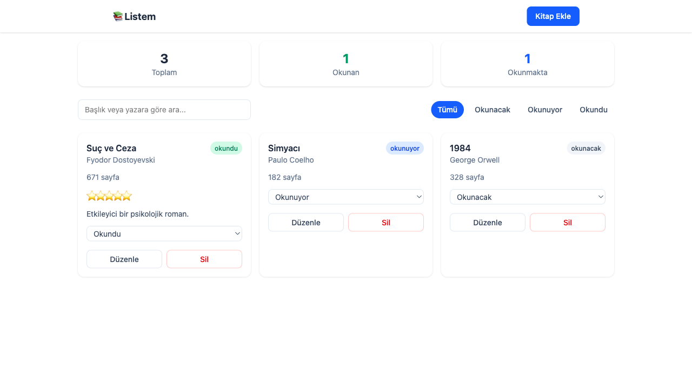

# 📚 Okuma Listem

Okumak istediğiniz, okumakta olduğunuz ve okuduğunuz kitapları takip edebileceğiniz basit bir kitap takip uygulaması. Bu proje bir yazılım kursunun bitirme projesi olarak, eğitim amaçlı geliştirilmiştir.

## Ekran Görüntüsü



## Kullanılan Teknolojiler

- [React](https://react.dev/) (Vite ile kuruldu)
- [Vite](https://vite.dev/)
- [Tailwind CSS](https://tailwindcss.com/) (v4, Vite eklentisi ile)
- [React Router](https://reactrouter.com/)
- Veri saklama: tarayıcının **LocalStorage**'ı (backend yok)

## Özellikler

- **Ekle:** Yeni kitap ekleme formu, doğrulama ile (başlık/yazar boş olamaz, sayfa sayısı pozitif olmalı)
- **Listele:** Kitapları kart olarak listeleme, istatistik özeti (toplam/okunan/okunmakta), arama (başlık/yazar) ve duruma göre filtreleme
- **Güncelle:** Mevcut kitabı düzenleme ve karttan hızlı durum değiştirme
- **Sil:** Onay penceresi ile (yanlışlıkla silmeyi önlemek için)

## Kurulum

```bash
# Bağımlılıkları yükle
npm install

# Geliştirme sunucusunu başlat
npm run dev

# Üretim (production) derlemesi al
npm run build
```

## Canlı Demo

[Canlı demo linki buraya eklenecek]

## GitHub Reposu

[GitHub repo linki buraya eklenecek]
